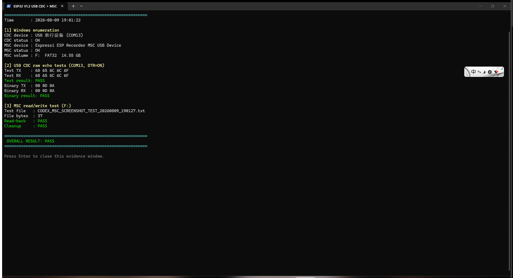

# ESP32-S3 WiFi 数据记录仪 V1.2 开发记录

## 项目信息

- 开发工程：`esp_recorder_v1.2_dev`
- 原始只读工程：`esp_recorder_v1.1_full_features`
- 芯片：ESP32-S3
- ESP-IDF：v5.4
- Target：`esp32s3`
- 开发分支：`feature/v1.2-product-completion`

## 这次做了什么

### 1. 保留原工程，建立 V1.2 开发副本

1. 将 V1.1 工程复制为 `esp_recorder_v1.2_dev`，没有在原始工程中继续修改。
2. 在开发副本中建立 Git 基线，保留 `main` 分支和 `handover-v1.1-baseline` 标签。
3. 新建 `feature/v1.2-product-completion` 分支进行后续开发。
4. 修复复制后 `dependencies.lock` 中 TinyUSB 本地组件路径，使开发副本可以独立使用当前机器上的组件。

### 2. 检查原有功能和数据链路

代码检查确认工程已有以下主要模块：

- WiFi AP+STA 和手机网页
- CH1、CH2 双路 UART
- CH1 RX 到 CH2 TX、CH2 RX 到 CH1 TX 的数据路由
- SD 卡记录和网页文件管理
- NVS 参数保存
- USB MSC U盘
- TinyUSB CDC 底层初始化

原来的 CDC 接收回调没有应用层处理，PC 数据虽然能够进入底层，但没有安全的任务和队列负责接收、发送及统计。

### 3. 增加 USB CDC 通信基础层

新增 `usb_cdc_bridge` 模块，完成：

- CDC RX 回调只负责复制数据并放入队列，不执行耗时业务。
- 独立 `cdc_rx_task` 处理接收数据。
- 所有 CDC 发送统一进入 TX 队列，由 `cdc_tx_task` 串行发送。
- 单帧最大 512 字节，RX/TX 队列深度均为 8。
- 支持包含 `00 0D 0A` 的二进制数据，不使用 `strlen()` 计算二进制长度。
- 增加连接状态、RX/TX 字节数和丢弃字节数统计。
- 处理 USB 未连接、队列满、TX busy 和中途拔出等情况。
- 保留可关闭的 `USB_CDC_DEBUG_ECHO` 调试回显，暂时没有发明正式上位机协议。

本阶段没有修改 UART、数据路由、网页、SD 记录和 MSC 的原有业务行为。

### 4. 编译和烧录

- `idf.py build` 实际执行成功，退出代码为 0。
- 固件：`build/esp_recorder_v1.0.bin`
- 当次应用固件大小：`0xfd1d0` bytes。
- VS Code ESP-IDF 烧录输出出现 `Flash Done`。

编译成功只代表代码可以配置、编译和链接；后续又进行了真实开发板验证。

### 5. USB CDC + MSC 实机验证

Windows 在同一个 ESP32-S3 USB 复合设备上同时识别到：

- CDC：`VID_303A&PID_4002`，测试时为 `COM13`
- MSC：`ESP Recorder MSC USB Device`，测试时为 FAT32 `F:` 盘

实际测试结果：

| 测试项 | 发送/操作 | 实际结果 |
| --- | --- | --- |
| CDC 文本回显 | 发送 `hello` | 收到相同的 5 字节，PASS |
| CDC 二进制回显 | 发送 `00 0D 0A` | 收到相同的 3 字节，PASS |
| MSC 读写 | 创建临时文件并读回 | 内容完全一致，PASS |
| MSC 清理 | 删除临时测试文件 | 删除成功，PASS |
| CDC + MSC 共存 | 串口回显期间检查U盘 | 两个接口同时正常枚举，PASS |

CDC 测试需要打开 DTR；DTR 关闭时固件会认为 PC 串口尚未连接。

验证截图：



复测脚本：`artifacts/verify_usb_cdc_msc.ps1`

## 主要代码改动

| 文件 | 内容 |
| --- | --- |
| `main/usb_cdc_bridge.c` | RX/TX 队列、独立任务、发送接口、回显和统计 |
| `main/usb_cdc_bridge.h` | Bridge 对外接口、帧大小、队列深度和调试开关 |
| `main/usb_cdc.c` | 保留唯一 TinyUSB 初始化，补充 CDC 状态和回调接入 |
| `main/usb_cdc.h` | 补充底层 CDC 接口声明 |
| `main/app_main.c` | 初始化 USB CDC bridge，移除原来的空应用回调 |
| `main/CMakeLists.txt` | 将 `usb_cdc_bridge.c` 加入构建 |

CDC 和 MSC 继续共用一套 TinyUSB 复合设备描述符：CDC 使用 interface 0/1，MSC 使用 interface 2，接口和 endpoint 没有冲突。

## 怎么重新验证

1. 编译并烧录当前分支固件。
2. Type-C 连接电脑，确认系统出现 ESP32 原生 CDC 串口和 MSC 盘符。
3. 关闭占用 CDC 串口的 ESP-IDF Monitor 或串口助手。
4. 在 PowerShell 中运行：

```powershell
powershell -ExecutionPolicy Bypass -File .\artifacts\verify_usb_cdc_msc.ps1
```

5. 看到 `OVERALL RESULT: PASS` 表示文本回显、二进制回显和U盘临时文件读写均通过。

串口号和U盘盘符由 Windows 动态分配，脚本当前按本次测试环境使用 `COM13` 和 `F:`。

## 当前还没有完成

- USB CDC 正式命令协议和参数配置
- USB WiFi 配网
- Type-C 实时转发 CH1/CH2 数据
- PC 上位机 GUI
- 后台服务器连接和远程控制
- OTA、IMU 升级、RS485、CAN、网页认证
- CDC 队列长时间压力测试和反复拔插测试

这些功能需要继续分阶段开发，不能因为 CDC 回显通过就标记为完成。

## 相关文档

- `docs/V1_1_BASELINE.md`：V1.1 到 V1.2 的开发基线
- `docs/V1_2_DEVELOPMENT_PLAN.md`：现有架构和后续开发计划
- `docs/STAGE2_USB_CDC.md`：USB CDC 基础层详细设计和编译记录
